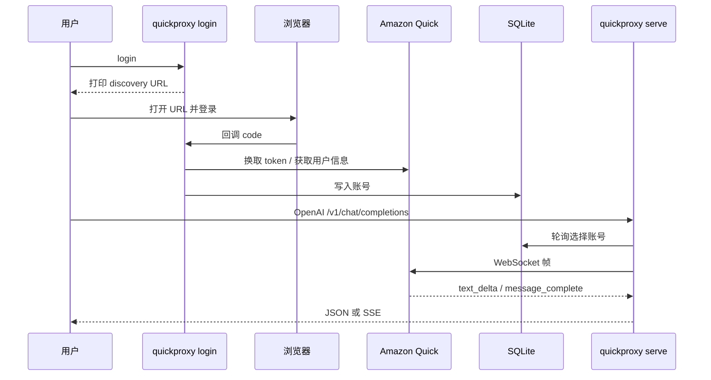

# QuickWork / Amazon Quick → OpenAI API

把 Amazon Quick（QuickWork）桌面端的聊天能力转换成 **OpenAI 兼容的 HTTP API**。

项目是单一 Go 可执行文件：原生 OAuth 登录、账号存储、token 刷新和反代全部由 Go 完成，不需要 Python，也不用启动官方桌面应用或 outpost 进程。登录后由反代把 `/v1/chat/completions` 请求转换为 QuickWork WebSocket 帧，并把结果转回普通 JSON 或 SSE。

> 非官方项目，与 Amazon / AWS 无关联。请仅在你拥有或获得明确授权的账号上使用，并遵守相关服务条款。

## 功能

- `POST /v1/chat/completions`，支持流式（SSE）与非流式响应
- `GET /v1/models`，返回本地模型别名
- 原生 social 登录（AWS IAM Identity Center OIDC）与企业 OIDC 登录，使用 PKCE
- 支持服务器/远程登录：手动粘贴浏览器 callback URL，无需开放本地回调端口
- 服务端配置集中存放在 `config.json`
- 账号存放在 SQLite（`data/quickwork.db`），支持多账号轮询与自动刷新
- 请求按轮询选择账号；到期 token 自动 refresh；失败时切换到下一个账号重试
- 可选本地 API key 保护
- 默认每轮对话结束后删除上游会话，避免污染聊天列表
- 保留 `assistant.tool_calls` / `role: tool` 历史，客户端工具调用链不会丢上下文
- 客户端 `tools` / `functions` 通过 `<client_tool_call>` 协议桥接；代理返回 OpenAI `tool_calls`，实际执行仍在客户端
- 上游原生 `tool_start` / `tool_arguments` / `tool_result` 在名称匹配时也会转成 OpenAI `tool_calls`
- 使用上游 `turn_usage` 返回 `usage` 与 `prompt_tokens_details.cached_tokens`
- `system` / `developer` 消息通过 Quick 原生 `custom_prompt` 传递，保留角色和顺序；不拼进 user 文本

## 环境要求

- Go 1.26+（仅构建时需要）
- 一个可正常登录的 Amazon Quick 账号
- 浏览器与 `quickproxy login` 运行在**同一台机器**，且本机回调端口（默认 `18080`）可被浏览器访问

## 快速开始

### 1. 构建

```bash
cd quickwork-openai
go build -o bin/quickproxy.exe ./cmd/quickproxy   # Windows
# go build -o bin/quickproxy ./cmd/quickproxy     # macOS / Linux
```

### 2. 登录上游账号

```bash
./bin/quickproxy login --provider social
```

首次运行会在当前目录创建 `config.json`，并在 `data/quickwork.db` 初始化 SQLite。终端会打印一个 discovery URL，例如：

```
https://quick.aws.com/sn?qwSurface=desktop:<nonce>:18080:1.2.4660
```

在**同一台机器**的浏览器中打开它，完成登录。工具会接收浏览器回调、完成 OAuth / PKCE、交换 token、获取用户信息，并把账号写入 SQLite。完成后终端只打印账号显示信息、`ws_host` 和到期时间，不打印 token。

企业 SSO 登录：

```bash
./bin/quickproxy login --provider enterprise --region us-east-1
```

需要登录多个账号时，重复执行 `login` 即可。相同 email + tenant 的账号会更新，不会重复插入。

#### 服务器 / 远程登录（手动回填 callback URL）

如果 `quickproxy` 跑在服务器上，浏览器访问不到服务器的 `localhost:18080`，使用手动模式：

```bash
./bin/quickproxy login -manual
```

流程：

1. 终端打印 discovery URL，在任意机器用浏览器打开并登录。
2. 浏览器会跳转到 `http://localhost:18080/callback?...`。这个页面可能打不开，属正常现象；从地址栏复制**完整 URL**，粘贴回终端。
3. 终端会打印 authorize URL；继续在浏览器打开并完成登录。
4. 浏览器会跳转到 `http://127.0.0.1:18080/?code=...`；同样复制地址栏的完整 URL，粘贴回终端。
5. 工具完成 token 交换并写入 SQLite。

工具会根据 URL 参数自动判断阶段：`nonce=...` 是 discovery callback，`code=...&state=...` 是授权完成 callback。贴入 authorize URL、discovery URL、重复的 discovery callback 或带 fragment 的 callback 都会被识别并提示下一步，不会重复注册 OAuth client。

整个过程不需要服务器开放回调端口；回调端口只用于生成浏览器地址。也可以把 callback URL 通过 stdin 管道传入，便于脚本化。

### 3. 启动反代

```bash
./bin/quickproxy serve
```

服务读取当前目录的 `config.json`。默认监听 `127.0.0.1:8080`。如果 `api_keys` 为空，代理关闭 API key 鉴权，适合纯本机使用。

### 4. 调用

```bash
curl http://127.0.0.1:8080/v1/models \
  -H "Authorization: Bearer local"
```

```bash
curl http://127.0.0.1:8080/v1/chat/completions \
  -H "Authorization: Bearer local" \
  -H "Content-Type: application/json" \
  -d '{
    "model": "smart",
    "stream": true,
    "messages": [{"role": "user", "content": "用三句话解释 QUIC"}]
  }'
```

Python SDK：

```python
from openai import OpenAI

# api_keys 为空时 api_key 可填任意值；配置后填对应 key。
client = OpenAI(base_url="http://127.0.0.1:8080/v1", api_key="local")

for chunk in client.chat.completions.create(
    model="smart",
    messages=[{"role": "user", "content": "hello"}],
    stream=True,
):
    print(chunk.choices[0].delta.content or "", end="")
```

## 配置 `config.json`

`quickproxy serve` / `login` 在文件不存在时会写入默认配置。完整示例：

```json
{
  "addr": "127.0.0.1:8080",
  "database": "data/quickwork.db",
  "api_keys": [],
  "models": ["smart", "fast", "balanced", "auto"],
  "default_model": "smart",
  "request_timeout": "20m",
  "refresh_before": "10m",
  "max_attempts": 3,
  "app_version": "1.2.4660",
  "surface": "QUICK_WORK_DESKTOP_WINDOWS",
  "outpost_id": "",
  "working_session_id": "",
  "timezone": "UTC",
  "locale": "en-US",
  "thinking_effort": "",
  "keep_sessions": false,
  "oauth": {
    "provider": "social",
    "build_stage": "prod",
    "region": "",
    "callback_port": 18080,
    "timeout": "1h"
  }
}
```

| 字段 | 默认 | 说明 |
|---|---|---|
| `addr` | `127.0.0.1:8080` | HTTP 监听地址 |
| `database` | `data/quickwork.db` | SQLite 文件；相对路径基于 `config.json` 所在目录 |
| `api_keys` | `[]` | 允许的本地 API key；为空时关闭鉴权 |
| `models` | `smart,fast,balanced,auto` | `/v1/models` 返回值与 model 白名单 |
| `default_model` | `smart` | 未知 model 的映射 |
| `request_timeout` | `20m` | 单次请求的总超时，包含原生工具处理和生成时间 |
| `refresh_before` | `10m` | token 距离到期小于该值时自动 refresh |
| `max_attempts` | `3` | 单次请求最多尝试的账号数 |
| `app_version` | `1.2.4660` | 上游握手使用的 appVersion |
| `surface` | `QUICK_WORK_DESKTOP_WINDOWS` | 上游握手使用的 surfaceType |
| `outpost_id` / `working_session_id` | 空 | 上游握手可选字段 |
| `timezone` / `locale` | `UTC` / `en-US` | `user_message` 中的时区与语言 |
| `thinking_effort` | 空 | `smart`、`balanced` 的默认推理强度，可设 `off`、`low`、`medium`、`high` |
| `keep_sessions` | `false` | 保留上游会话，不在一轮结束后删除 |
| `oauth.provider` | `social` | `login` 默认 provider |
| `oauth.build_stage` | `prod` | `prod`、`beta`、`integ`、`dev` |
| `oauth.region` | 空 | 企业 discovery 的 region 前缀；social 使用 discovery 返回的 IDC region |
| `oauth.callback_port` | `18080` | 本机 OAuth 回调端口 |
| `oauth.timeout` | `1h` | 等待浏览器完成登录的超时 |

时间字段接受 Go duration 字符串（`30s`、`5m`、`1h`）。

需要 API key 时，把 key 写进 `api_keys`：

```json
{
  "api_keys": ["sk-local"]
}
```

之后请求需带 `Authorization: Bearer sk-local`（或 `X-Api-Key: sk-local`）。

## 命令

| 命令 | 说明 |
|---|---|
| `quickproxy serve` | 启动反代 |
| `quickproxy login` | 浏览器 OAuth 登录并写入 SQLite |
| `quickproxy accounts` | 列出账号、到期时间、使用次数与最近错误 |
| `quickproxy refresh` | 刷新全部账号的 token |
| `quickproxy refresh -account ID` | 只刷新一个账号 |
| `quickproxy logout -all` | 删除全部账号 |
| `quickproxy logout -account ID` | 删除一个账号 |

所有命令都支持 `-config PATH`，默认 `config.json`。

从旧版升级：旧的 `auth/quickauth.py` 已移除，`data/session.json` / `data/upstream.json` 不再读取。请重新执行一次 `quickproxy login`；之后所有账号都由 SQLite 管理。

`login` 常用参数：

| 参数 | 默认 | 说明 |
|---|---|---|
| `-provider` | `config.oauth.provider` | `social`、`enterprise`、`gateway`、`social_gateway` |
| `-stage` | `config.oauth.build_stage` | `prod`、`beta`、`integ`、`dev` |
| `-region` | `config.oauth.region` | 企业 discovery 的 region 前缀；social 使用 discovery 返回的 IDC region |
| `-port` | `config.oauth.callback_port` | 本机回调端口 |
| `-timeout` | `config.oauth.timeout` | 等待浏览器完成登录的超时 |
| `-open` | 关闭 | 同时用默认浏览器打开 URL |
| `-manual` | 关闭 | 不监听本地回调端口，手动粘贴浏览器地址栏中的 callback URL（适合服务器） |

## 多账号轮询

账号存在 SQLite 的 `accounts` 表，按 ID 轮询：

1. 每个请求选择下一个启用账号。
2. 如果 token 在 `refresh_before` 内到期，先用 refresh token 自动刷新。
3. 刷新失败或账号不可用时记录 `last_error`，跳过该账号继续轮询。
4. 单次请求最多尝试 `max_attempts` 个账号；非流式请求和尚未向客户端发送任何数据的流式请求会自动换号重试。
5. 一旦流式响应已经开始，就不会中途换号，避免客户端收到重复内容。

`quickproxy accounts` 可查看每个账号的状态；`quickproxy refresh` 会刷新全部账号。上游 refresh token 失效时，对应账号需要重新执行 `quickproxy login`。

## 工作方式



- 登录完全在 `quickproxy login` 内完成，不依赖官方桌面应用或 outpost。
- `quickproxy serve` 从 SQLite 读取 `jwt`、`ws_host` 和 `provider`，连接上游 WebSocket。
- 上游不是 OpenAI HTTP API，而是 WebSocket JSON 帧；`internal/proxy/wire.go` 负责帧编码与 event-stream 解码。
- 长连接每 25 秒通过同一原生编码器发送带时间戳的应用层 `ping`，同时保留 WebSocket 控制 Ping。仅发送控制帧不能重置上游“95 秒未收到客户端数据帧”的空闲检测。整个请求仍受 `request_timeout` 限制。
- 流式请求等待原生工具或生成长回复时，每 15 秒向客户端发送 SSE 保活（Anthropic 为 `ping`）。总超时返回 `upstream_timeout`；未完成的上游回复不会被当作成功或提交为可续接历史。
- 文件下载遇到 403/404 时，会重新获取签名地址并有限重试；持续失败仍明确报错。客户端工具模式会忽略 Quick `file_read_image` 的内部检查缩略图，避免它阻塞真正的客户端工具调用。上游先报错、客户端随后关闭连接时，请求日志保留上游失败原因。

### 提示词与工具调用

- 常规请求的 `system` / `developer` 消息按原顺序保留角色标记，写入 `user_message.payload.custom_prompt`，与对话正文分开。
- Quick 的官方客户端使用 `custom_prompt` 承载应用上下文；旧实现使用的 `system_prompt` 在此次 social 路径实测中被上游忽略，现已移除。没有调用方指令、也没有客户端工具时，不额外注入上下文。
- 客户端工具定义和 RPC 编码协议也放入 `custom_prompt`，将工具参数编码为客户端能识别的事件，不再依赖追加到用户正文中的协议。
- 该应用上下文入口不会更改 Quick 的服务权限或开放未提供的工具。已验证指令数据传递、普通用户请求与项目指令的优先关系、system 更新和真实客户端工具闭环；不代表所有模型行为都能获得与 Anthropic 服务完全相同的保证。
- 客户端历史中的 `assistant.tool_calls` 会转成带 `id` / `name` 的文本，`role: tool` 会转成带 `call_id` / `name` 的工具结果，供上游继续推理。
- 客户端在 `tools` / `functions` 中声明的工具会以 `<client_tool_protocol>` 追加到应用上下文 `custom_prompt`；模型用 `<client_tool_call>{"name":"...","arguments":{...}}</client_tool_call>` 发起调用。
- 如果客户端 system prompt 要求“必须用原生工具调用”或“禁止把工具调用写成文本”，桥接会附加一条后端能力说明：原生函数调用不可用，仅对列出的客户端工具改用该标记，其他指令保持不变。这是工具协议适配，不是通用提示词注入。
- 代理解析该标记并返回 OpenAI `tool_calls`，但**不执行工具**；客户端执行后把结果作为 `role: tool` 发回，代理再转成文本上下文。
- 有客户端工具时，普通正文仍按上游片段发送。工具标记和疑似工具请求的开头 JSON 会暂存识别；完整的 `tool_calls` 在成功结束时返回。
- `/v1/chat/completions` 支持按请求指定 `reasoning_effort`。`xhigh`、`max` 映射到 Quick 的 `high`，`none` 映射到 `off`。Quick 返回的思考片段通过独立的 `reasoning_content` 字段传给支持它的客户端，具体显示方式由客户端决定。
- `tool_choice: "none"` 会关闭桥接；`tool_choice` 为具体函数时只接受该函数。上游原生工具事件在名称匹配时仍可转成 `tool_calls`。
- 非流式响应中，工具调用放在 `choices[0].message.tool_calls`；桥接调用或只有工具且没有最终文本时 `finish_reason` 为 `tool_calls`，否则为 `stop`。
- 同一会话固定上游账号与原生 `thread_id`。代理持久化账号路由和历史指纹，匹配调用方确认的历史，只发送新增消息和工具结果，不再每轮拼接完整历史。客户端继续按 OpenAI/Anthropic 协议发送历史即可；可选 `X-Thread-Id` 为调用方的隔离标识或代理返回的会话标识，不能用于访问其他 API key 的会话。
- 完成的会话可跨 WebSocket 重连和代理重启续接，闲置 24 小时过期。历史被编辑、system/tools/模型改变或同一历史产生并发分支时使用新原生会话，并从调用方历史重建，避免污染原线程。JSON Schema 声明的工具参数默认值会参与等价匹配；其他参数变更按历史分支处理。
- 请求尚未发往上游时可重试连接；一旦写入 `user_message`，结果未知的失败不会自动重放。中断或未完整返回的轮次会退出可复用状态，客户端重试从其最后确认的历史新建会话，避免重复提交可能执行过的原生操作。进程启动时同样淘汰未完成的轮次。
- Quick 单条消息的 64 KiB 限制针对原生 JSON，不包含 Base64 传输外层，也不是整个会话的上下文窗口。新增消息、首轮 system/tools 或附件超出单条消息限制时，通过官方鉴权附件上传接口发送完整、未压缩的 JSON/文件，经上游附件检查允许后再交付到绑定的线程；WebSocket 只传文件引用。不截断历史、工具说明、参数或工具返回。
- 项目规范尽量保留在 `custom_prompt`；仍无法容纳时，完整规范进入附件的 `system_instructions` 字段，`custom_prompt` 明确要求按应用规范读取。该分支需要上游成功读取附件，可能增加原生工具步骤、耗时与用量；不保证与模型直接接收全部 system token 的行为完全相同。上传内容不使用公开下载地址；正常会话元数据只保存路由和指纹，诊断日志继续遵循其已有的正文捕获与保留策略。
- 代理请求体上限为 80 MiB，单个上下文上传文件上限为 50 MiB；附件引用数量仍需容纳于原生消息中。超限返回明确错误，不静默丢弃内容。大附件上传已在 social 路径实测；gateway 大附件暂不支持，返回明确错误。
- 原生上游曾报告 `context_window: 1000000`；这不等于本适配已验证稳定接收完整 1M Tokens。大文件可访问、增量历史可续接与模型实际读取所有 token 是不同的验证项，不能据此宣称已完整支持 1M。
- 上游顶层、嵌套对象和数组中的错误原因会保留并脱敏。Quick 明确的内容过滤中止返回 `content_filter`；这类请求拒绝和原生尺寸拒绝不会重试其他账号或标记账号异常。已开始的 SSE 使用错误事件，尚未开始的 OpenAI 请求使用 HTTP 400。此适配不会绕过 Quick 的内容过滤。

## 安全与隐私

- `data/quickwork.db` 包含 access token、refresh token、client secret 和用户信息，已被 `.gitignore` 排除。
- `config.json` 默认不含密钥；如果写入 `api_keys`，不要提交真实 key。
- 登录密码只在 Amazon 的浏览器页面中输入，本项目不会保存密码。
- 反代默认只监听 `127.0.0.1`。不要把端口直接暴露到公网；如确需远程访问，请自行加 TLS 与访问控制。
- `quickproxy logout -all` 会删除本地账号与 refresh 状态。
- 不要提交或分享 `data/` 目录。

## 限制

- 提供聊天补全、原生附件传递和异步视频制作。`temperature`、`max_tokens`、`stop`、`response_format` 等采样参数不会传给上游；`n > 1` 会返回 400。
- 工具由客户端执行。代理把模型输出中的工具标记转换成 `tool_calls`，其余正文随生成进度发送。
- `custom_prompt` 已在 social 路径验证；enterprise / gateway 的上下文行为仍待验证。
- `model` 会映射为上游 agent mode：`smart`、`fast`、`balanced`、`auto`。
- 上游没有模型列表 API；`/v1/models` 返回的是本项目配置的别名。
- social / enterprise 路径已做真实账号验证；`gateway` / `social_gateway` 的 CBOR 路径仍属实验性。
- 上游 access token 通常约 1 小时到期，反代会按 `refresh_before` 自动刷新；也可手动执行 `quickproxy refresh`。
- 新会话轮询选择账号，续接固定原账号；不按 token 用量或配额调度。
- 上游接口可能随官方客户端更新而变化；若登录或聊天失败，先重新执行 `quickproxy login`。
- 本项目与 Amazon / AWS 无关联，不提供任何服务保证。

## 故障排查

| 现象 | 处理 |
|---|---|
| `cannot listen on 127.0.0.1:18080` | 关闭占用 18080 的其他进程，或用 `-port` / `oauth.callback_port` 换端口 |
| 浏览器登录后一直等待 | 确认浏览器与命令在同一台机器，且回调端口可达；远程服务器请用 `login -manual` |
| 服务器上 `localhost:18080` 回调打不开 | 这是预期现象；用 `login -manual`，复制浏览器地址栏的完整 URL 回填 |
| `upstream_session_unavailable` / `no accounts configured` | 运行 `quickproxy login` |
| `401 invalid_api_key` | 检查 `config.json` 的 `api_keys` 与请求头中的 key 是否一致 |
| 登录页面报错 | 查看终端输出的错误；确认 `-provider` 与账号类型匹配 |
| 多账号请求总是失败 | 运行 `quickproxy accounts` 查看 `last_error`；对失效账号重新 `login` 或 `logout -account ID` |
| token 过期 | 通常自动刷新；也可运行 `quickproxy refresh` |

## 目录

```
quickwork-openai/
  config.json              服务端配置（首次运行自动生成）
  cmd/quickproxy/          CLI：serve / login / accounts / refresh / logout
  internal/config/         config.json 加载与默认值
  internal/oauth/          原生 OAuth、PKCE、token refresh、user info
  internal/store/          SQLite 账号存储
  internal/accounts/       多账号轮询与自动刷新
  internal/proxy/          WebSocket codec、OpenAI handler
  data/quickwork.db        运行期账号库（gitignored）
```

## 网页账号管理（此部署扩展）

本分支提供 `/admin/` 账号控制台，包含管理员登录、账号列表与搜索筛选、
远程 OAuth 授权、刷新、启用/停用和删除，以及 API 接入信息。
沿用原有 SQLite 账号库和轮询逻辑；账号列表不会返回 access token、refresh token 或 client secret。

先运行 `quickproxy admin-hash -generate` 生成管理员密码与 PBKDF2 密码摘要，
妥善保存输出中的密码，将 `password_hash` 填入配置：

```json
{
  "admin": {
    "enabled": true,
    "username": "admin",
    "password_hash": "填写 admin-hash 生成的 password_hash",
    "public_url": "https://your-domain.example"
  }
}
```

重启服务后访问 `https://your-domain.example/admin/`。
API Key 和管理员密码分别用于 API 与控制台，API Key 不能登录控制台。
`public_url` 必须与浏览器访问的 HTTPS 来源一致；开发时允许使用 HTTP 回环地址。
反向代理需要保留原始 Host 和 Origin，并关闭 `/admin/` 响应缓存。

默认登录有效期为 12 小时，勾选“记住登录 30 天”后，此浏览器可在 30 天内自动进入后台。
登录状态保存在 SQLite，普通服务重启与版本更新会保留仍有效的登录；退出登录会立即撤销凭证。
浏览器使用 Secure、HttpOnly、SameSite=Strict Cookie，数据库只保存随机会话凭证的 SHA-256
摘要、CSRF 值和到期时间，不保存管理员明文密码或可直接使用的原始 Cookie。
最多保留 64 个有效登录，过期记录会在登录及启动时清理。
登录表单提供标准自动填充属性，成功后移除表单并重新加载后台；初始加载保留浏览器已填入的密码。
是否弹出保存密码提示由浏览器的密码管理器决定，参见 [浏览器登录表单指南](https://web.dev/articles/sign-in-form-best-practices)。

添加账号时先生成授权链接，打开 Amazon Quick 登录页面。页面跳转到
`localhost` 后复制完整地址，回到控制台粘贴并提交；按提示再次授权并提交
含 `code` 和 `state` 的回调地址即可完成。localhost 页面无法打开属于预期行为。
每次授权有效期为 30 分钟，关闭窗口会取消该流程。

修改管理员密码时，重新生成摘要并更新 `config.json` 中的 `admin.password_hash`，
随后重启服务。也可将新密码通过标准输入传给 `quickproxy admin-hash`，只输出摘要。
管理员密码摘要、用户名或后台来源地址改变后，已有登录会失效；仅重启服务不再撤销登录。

## 图片、文件与视频（此部署扩展）

聊天接口会将媒体原始字节传给 Quick。`messages[].content` 支持
`image_url`（公开 HTTPS URL 或 Base64 data URL）、`file` / `input_file`
（`filename` 与 `file_data` 或 `file_url`）和 `input_audio`（Base64，mp3/wav/flac/ogg）。
单张图片最大 10 MiB，最多 20 个附件、合计 50 MiB；请求体上限 80 MiB。
不接受其他平台的 `file_id`。媒体 URL 不能访问内网或本机。
已验证图片识别与文本文件读取；音频传递和其他文档类型的理解能力以账号上游支持为准。
暂未提供视频内容理解输入。

Quick 生成的工作区文件会在会话清理之前下载到数据库旁边的 `media/` 目录，
响应的 `message.attachments` 给出文件信息，正文中的 `qw-file://` 转为可访问链接。
流式响应在文件缓存完成后返回链接及 `delta.attachments`。
单个生成文件最大 256 MiB。下载支持 Range，需使用对应 API Key 或有效签名链接；
签名有效期 24 小时，可重新读取视频任务获取新链接。
服务启动需要数据库目录可写，服务器需安装 `ffmpeg` / `ffprobe`，
以校验 MP4 并在需要时转为浏览器可播放的 H.264/yuv420p。

管理员可在 `/admin/#videos` 输入描述、添加参考图片、提交任务并预览/下载。
API 使用原有 API Key，新增以下路由：

| 方法 | 路径 | 用途 |
| --- | --- | --- |
| POST | `/v1/videos` | 提交视频任务，返回 202 与任务 ID |
| GET | `/v1/videos` | 最近 100 个本 Key 的任务 |
| GET | `/v1/videos/{id}` | 查询状态，完成后返回 `url` |
| GET | `/v1/videos/{id}/content` | 跳转至带签名的成片下载地址 |

```bash
curl https://your-domain.example/v1/videos \
  -H "Authorization: Bearer YOUR_API_KEY" \
  -H "Content-Type: application/json" \
  -d '{"model":"smart","prompt":"浅色背景，蓝色小球水平弹跳的简洁动画","seconds":3,"size":"1280x720"}'
```

图片制作视频可在 JSON 中增加 `input_reference`（图片 data URL 或公开 URL），
也支持 `multipart/form-data` 的同名文件字段。`seconds` 范围 1–30，
`size` 支持 `1280x720`、`720x1280`、`1024x1024`、`1920x1080`。
这些是提交给 Quick 的制作要求，最终成片规格以实际输出为准。
状态为 `queued`、`in_progress`、`completed` 或 `failed`，失败原因见 `error` 和 `result`。
同时最多两个任务，超限返回 429。单个任务最长 30 分钟；重启会将未完成任务标记失败。
此接口使用 Quick 当前账号的制作工具，不能据此假定拥有 Sora、Veo 等视频模型权限。
本次已实际验证文字几何动画与参考图片缩放视频，均由 Quick 的代码工具渲染；
专用生成式视频模型尚未验证。接口是本项目的任务封装，并非完整的 OpenAI Videos SDK 实现。

## Claude Code 接入（此部署扩展）

同时提供 `POST /v1/messages` 与 `POST /v1/messages/count_tokens`，
可使用 `Authorization: Bearer` 或 `x-api-key` 验证原有代理 API Key。
支持普通回复、Anthropic SSE、客户端工具定义、`tool_use` 与 `tool_result`、
图片和文档输入。工具在 Claude Code 本机执行，由原有工具桥接生成调用参数。
同时接受顶层 `system` 与多轮历史中的 `role: "system"` 文本更新，按顺序传递到 Quick 的应用上下文。

此次已用真实 Claude Code 验证：两个模块的代码修复、12 项单元测试、9 轮连续工具流程、
stdio MCP 工具调用、MCP 错误反馈后的重试，以及跨多轮保留的项目编码规范。
测试不覆盖任意大型仓库、所有 MCP 传输/认证方式或无限工具轮数；真实上下文窗口上限仍未测定。

Claude Code 的 Base URL 使用域名根地址，**不要添加 `/v1`**。
管理员可在 `/admin/#connection` 直接复制带当前 Key 的 PowerShell 命令或 VS Code 配置。
例如在 PowerShell 当前终端中运行：

```powershell
$env:ANTHROPIC_BASE_URL = 'https://your-domain.example'
$env:ANTHROPIC_AUTH_TOKEN = 'YOUR_PROXY_API_KEY'
$env:ANTHROPIC_MODEL = 'smart'
$env:ANTHROPIC_DEFAULT_OPUS_MODEL = 'smart'
$env:ANTHROPIC_DEFAULT_SONNET_MODEL = 'smart'
$env:ANTHROPIC_DEFAULT_HAIKU_MODEL = 'fast'
$env:DISABLE_PROMPT_CACHING = '1'
$env:ENABLE_TOOL_SEARCH = 'false'
$env:MAX_THINKING_TOKENS = '0'
claude
```

上面环境变量适用于未在设置文件中配置同名值的情况。设置文件中的 `env` 可覆盖终端环境变量。
后台“复制 PowerShell 命令”会创建独立的 `~/.claude/quickwork.settings.json`，
并用 `claude --settings "$env:USERPROFILE\.claude\quickwork.settings.json" --model smart` 启动，
优先使用该配置。在 Claude Code 中执行 `/status` 检查地址和认证来源。
VS Code 插件使用用户 `settings.json` 中的 `claudeCode.environmentVariables`，
值为 `[{"name":"ANTHROPIC_BASE_URL","value":"https://your-domain.example"}, ...]`。
复制按钮会提供完整的 JSON；合并现有配置，重开 Claude Code 会话后生效。
若 `~/.claude/settings.json` 中已有同名 `env`，还需用“复制 Claude 设置”的内容同步该项。

这些模式名路由到当前 Quick 账号，不能据此认定实际使用了某个 Claude 官方型号。
此兼容层不提供 Anthropic 的缓存、签名思考块、服务端工具或延迟工具搜索。
`max_tokens`、采样参数和缓存控制不会传入 Quick；流式工具调用会缓冲至本轮结束。
Token 计数使用本地估算，响应带 `X-Token-Count-Method: estimate`，不是 Claude tokenizer 的准确计数。
语音、图片理解和长上下文能力仍取决于上游账号；该接口不代表完整 Anthropic API 实现。

## 诊断日志（此部署扩展）

后台 `/admin/#logs` 提供日志查询、请求追踪、级别筛选、内容搜索、自动更新和 JSONL 导出。
只有管理员登录会话可以读取日志；代理 API Key 不能访问此入口。
每个 API 响应都包含同一个 `X-Request-ID` / `request-id`，复制该值到后台“请求 ID”，
即可按时间正序查看同一次请求的处理过程。后台视频任务会沿用提交请求的 ID，另带 `job_id`。

```json
"logging": {
  "level": "debug",
  "file": "data/logs/quickwork.jsonl",
  "max_mb": 20,
  "backups": 5
}
```

`level` 可选 `debug`、`info`（默认）、`warn`、`error`、`off`，修改配置后重启服务生效。
`debug` 包含逐条上游事件的类型、顺序、字段结构与字节数；`info` 记录关键处理阶段。
日志同时输出到标准输出与 JSONL 文件，路径相对配置文件目录解析。
示例最多保存当前文件和 5 个轮转备份，每个 20 MiB；文件权限为 0600。
后台每次查询最多扫描最近 32 MiB，页面显示最多 500 条，导出最多 5000 条，达到上限会提示。
超出后台扫描范围时，可在服务器直接搜索轮转文件。

记录内容包括：消息角色统计和摘要、`custom_prompt` 是否存在及长度、工具定义摘要、
账号选择/刷新/重试、上游 thread/message/trace ID、WebSocket 连接和事件、首字节与首文本耗时、
真实上游用量、客户端工具调用、附件下载/缓存、视频任务和 ffmpeg 的失败阶段与错误。
流式请求即使已返回 HTTP 200，后续错误仍会单独记录，并计入访问日志的 `error_events`。

上述诊断事件不保存原始请求/响应正文、代码、工具参数/结果和文件内容；以大小与 SHA-256 摘要辅助比对。
错误详情会保留，凭据、Bearer、已知账号 Token、密码和 URL 查询参数会脱敏。
`debug` 的逐消息详情最多记录开头和结尾各 50 条；数组最多 100 项，字符串最多 2048 字节，
单条事件最多 64 KiB，超出会截断或改为概要。
日志开始记录后才有历史，不能补回之前的请求。

```bash
journalctl -u quickwork-openai.service -f -o cat
tail -f /opt/aws-quickwork-2api/data/logs/quickwork.jsonl
```

## 请求日志（此部署扩展）

后台 `/admin/#requests` 按调用展示最近 2,000 条概要：时间、密钥指纹、账号与会话、
请求模型和 Quick 路由、协议与流式标记、状态、真实上游输入/输出 Token、缓存读写和耗时。
支持状态筛选、关键字搜索、分页、详情、复制请求/返回、下载 JSON，以及跳转到该请求的诊断事件。
输入和输出用量包含同一次 API 调用内各次上游重试；没有上游用量时显示“—”。
这是调用记录，不会把一次 HTTP 请求的每个内部事件拆成多条调用。

覆盖 `/v1/messages`、`/v1/chat/completions`、`/v1/videos` 和后台提交视频的请求。
视频任务在后台完成或失败后更新同一条记录。HTTP 200 的 SSE 错误会标为失败；
账号重试或原生工具出错后最终成功的调用会标为“出错后成功”。
OpenAI 的 `finish_reason` + `[DONE]` 或 Anthropic 的停止原因 + `message_stop` 完整写出后，
客户端正常关闭连接仍记为成功；完成前断开或响应写入失败才记为取消。
流式完成状态独立于 512 KiB 正文捕获上限，长工具结果不会使结束标记丢失。
进程重启前仍在处理的记录会标为“已中断”，避免伪装成成功。

概要保存在 SQLite，保留最近 2,000 条。成功正文只在最多 32 MiB 的内存缓存中保留至多 1 小时，
重启或缓存清理后仍可查看概要。报错、取消和出错后成功的脱敏详情写入独立目录，
最多保留 7 天、100 条、128 MiB，超限清理最旧文件；每分钟及每次保存时清理。
目录默认 `data/request-details`，可用 `request_log_directory` 指定，路径相对配置文件解析。
文件权限 0600、目录 0700；预发布环境应指定独立目录。保留策略独立于 `logging.level`。

详情包含处理器读到的请求和实际返回；凭据、Cookie、已知 Token、密码、URL 查询参数及
媒体原始数据会脱敏或省略。单侧原始正文最多捕获 512 KiB，单段文本最多 128 KiB，
完整详情最多 2 MiB；未完整读取、超限或到期清理时会显示说明。
这里可包含项目规范、代码和工具返回的文字，因此读取、复制和下载均要求管理员会话；
普通代理 API Key 不能访问。检索 API Key 时，后台页面先转为指纹，避免把原始 Key 放进查询 URL。
新版本启用后开始积累记录，旧诊断事件不会自动转换为请求正文。

| 方法 | 路径 | 用途 |
| --- | --- | --- |
| GET | `/admin/api/requests` | `status`、`search`、`limit`（最多 100）、`offset` 筛选分页 |
| GET | `/admin/api/requests/{id}` | 调用概要与仍可用的脱敏详情 |
| GET | `/admin/api/requests/{id}/download` | 下载该调用的 JSON 详情 |

## 账号额度（此部署扩展）

后台账号列表的“剩余额度”栏紧凑显示月度与会话剩余比例。
展开行内“详情”可查看已用比例、上游重置时间、套餐和试用到期时间，以及上游用量警告。
数据来自 Quick 自身的 `profile/usage`，与本地请求日志的 Token 统计独立。
按上游 `used / limit` 计算比例，避免整数 `percent` 把少量消耗舍入成 0；
未知、无总额或不支持查询的窗口显示说明，不推断为 0 或无限额度。
不同窗口的原生计量单位可能不同，页面以比例展示，不换算成 Token、金额或可调用次数。

账号管理页可见时每分钟检查一次；后端正常数据缓存 2 分钟，点击“刷新额度”会主动重新查询。
并发查询同一账号会合并。单个账号查询失败不会影响其他账号；曾成功查询的数据会保留，
明确标为上次结果并显示原更新时间。失败短暂缓存 15 秒，避免连续请求放大上游故障。
查询会按需刷新登录状态，但不推进聊天轮询、不增加调用次数，也不会修改账号启用状态。
额度缓存仅存在内存，服务重启后重新获取；不保存或返回原始上游响应及额外账户字段。

接口只允许已登录的管理员访问；主动刷新还需要同源请求和 CSRF Token。

| 方法 | 路径 | 用途 |
| --- | --- | --- |
| GET | `/admin/api/quotas` | 查询各账号的额度，允许使用缓存 |
| POST | `/admin/api/quotas/refresh` | 重新获取各账号的额度 |

## License

本项目采用 [GNU General Public License v3.0](LICENSE) 授权。

## Acknowledgements

Thanks to the [LINUX DO](https://linux.do) community for its support.
