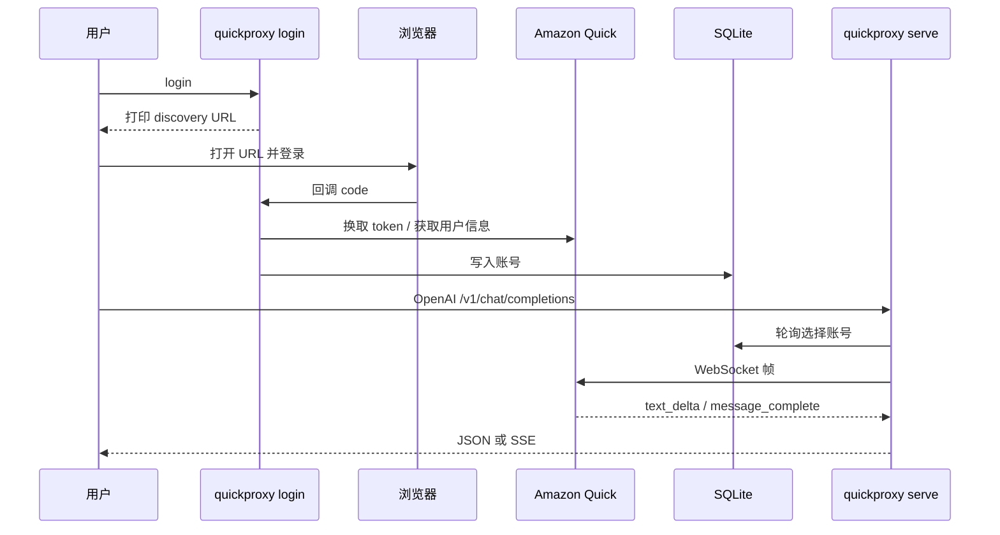

# QuickWork / Amazon Quick → OpenAI API

把 Amazon Quick（QuickWork）桌面端的聊天能力转换成 **OpenAI 兼容的 HTTP API**。

项目是单一 Go 可执行文件：原生 OAuth 登录、账号存储、token 刷新和反代全部由 Go 完成，不需要 Python，也不用启动官方桌面应用或 outpost 进程。登录后由反代把 `/v1/chat/completions` 请求转换为 QuickWork WebSocket 帧，并把结果转回普通 JSON 或 SSE。

> 非官方项目，与 Amazon / AWS 无关联。请仅在你拥有或获得明确授权的账号上使用，并遵守相关服务条款。

## 功能

- `POST /v1/chat/completions`，支持流式（SSE）与非流式响应
- `GET /v1/models`，返回本地模型别名
- 原生 social 登录（AWS IAM Identity Center OIDC）与企业 OIDC 登录，使用 PKCE
- 支持服务器/远程登录：手动粘贴浏览器 callback URL，无需开放本地回调端口
- 服务端配置集中存放在 `config.json`
- 账号存放在 SQLite（`data/quickwork.db`），支持多账号轮询与自动刷新
- 请求按轮询选择账号；到期 token 自动 refresh；失败时切换到下一个账号重试
- 可选本地 API key 保护
- 默认每轮对话结束后删除上游会话，避免污染聊天列表
- 保留 `assistant.tool_calls` / `role: tool` 历史，客户端工具调用链不会丢上下文
- 客户端 `tools` / `functions` 通过 `<client_tool_call>` 协议桥接；代理返回 OpenAI `tool_calls`，实际执行仍在客户端
- 上游原生 `tool_start` / `tool_arguments` / `tool_result` 在名称匹配时也会转成 OpenAI `tool_calls`
- 使用上游 `turn_usage` 返回 `usage` 与 `prompt_tokens_details.cached_tokens`
- `system` / `developer` 消息通过 QuickWork 原生 `system_prompt` 覆盖服务端基础提示词，并附加后端提示词覆盖声明，要求模型忽略上游追加的 system / agent 指令；不拼进 user 文本

## 环境要求

- Go 1.26+（仅构建时需要）
- 一个可正常登录的 Amazon Quick 账号
- 浏览器与 `quickproxy login` 运行在**同一台机器**，且本机回调端口（默认 `18080`）可被浏览器访问

## 快速开始

### 1. 构建

```bash
cd quickwork-openai
go build -o bin/quickproxy.exe ./cmd/quickproxy   # Windows
# go build -o bin/quickproxy ./cmd/quickproxy     # macOS / Linux
```

### 2. 登录上游账号

```bash
./bin/quickproxy login --provider social
```

首次运行会在当前目录创建 `config.json`，并在 `data/quickwork.db` 初始化 SQLite。终端会打印一个 discovery URL，例如：

```
https://quick.aws.com/sn?qwSurface=desktop:<nonce>:18080:1.2.4660
```

在**同一台机器**的浏览器中打开它，完成登录。工具会接收浏览器回调、完成 OAuth / PKCE、交换 token、获取用户信息，并把账号写入 SQLite。完成后终端只打印账号显示信息、`ws_host` 和到期时间，不打印 token。

企业 SSO 登录：

```bash
./bin/quickproxy login --provider enterprise --region us-east-1
```

需要登录多个账号时，重复执行 `login` 即可。相同 email + tenant 的账号会更新，不会重复插入。

#### 服务器 / 远程登录（手动回填 callback URL）

如果 `quickproxy` 跑在服务器上，浏览器访问不到服务器的 `localhost:18080`，使用手动模式：

```bash
./bin/quickproxy login -manual
```

流程：

1. 终端打印 discovery URL，在任意机器用浏览器打开并登录。
2. 浏览器会跳转到 `http://localhost:18080/callback?...`。这个页面可能打不开，属正常现象；从地址栏复制**完整 URL**，粘贴回终端。
3. 终端会打印 authorize URL；继续在浏览器打开并完成登录。
4. 浏览器会跳转到 `http://127.0.0.1:18080/?code=...`；同样复制地址栏的完整 URL，粘贴回终端。
5. 工具完成 token 交换并写入 SQLite。

工具会根据 URL 参数自动判断阶段：`nonce=...` 是 discovery callback，`code=...&state=...` 是授权完成 callback。贴入 authorize URL、discovery URL、重复的 discovery callback 或带 fragment 的 callback 都会被识别并提示下一步，不会重复注册 OAuth client。

整个过程不需要服务器开放回调端口；回调端口只用于生成浏览器地址。也可以把 callback URL 通过 stdin 管道传入，便于脚本化。

### 3. 启动反代

```bash
./bin/quickproxy serve
```

服务读取当前目录的 `config.json`。默认监听 `127.0.0.1:8080`。如果 `api_keys` 为空，代理关闭 API key 鉴权，适合纯本机使用。

### 4. 调用

```bash
curl http://127.0.0.1:8080/v1/models \
  -H "Authorization: Bearer local"
```

```bash
curl http://127.0.0.1:8080/v1/chat/completions \
  -H "Authorization: Bearer local" \
  -H "Content-Type: application/json" \
  -d '{
    "model": "smart",
    "stream": true,
    "messages": [{"role": "user", "content": "用三句话解释 QUIC"}]
  }'
```

Python SDK：

```python
from openai import OpenAI

# api_keys 为空时 api_key 可填任意值；配置后填对应 key。
client = OpenAI(base_url="http://127.0.0.1:8080/v1", api_key="local")

for chunk in client.chat.completions.create(
    model="smart",
    messages=[{"role": "user", "content": "hello"}],
    stream=True,
):
    print(chunk.choices[0].delta.content or "", end="")
```

## 配置 `config.json`

`quickproxy serve` / `login` 在文件不存在时会写入默认配置。完整示例：

```json
{
  "addr": "127.0.0.1:8080",
  "database": "data/quickwork.db",
  "api_keys": [],
  "models": ["smart", "fast", "balanced", "auto"],
  "default_model": "smart",
  "request_timeout": "5m",
  "refresh_before": "10m",
  "max_attempts": 3,
  "app_version": "1.2.4660",
  "surface": "QUICK_WORK_DESKTOP_WINDOWS",
  "outpost_id": "",
  "working_session_id": "",
  "timezone": "UTC",
  "locale": "en-US",
  "thinking_effort": "",
  "keep_sessions": false,
  "oauth": {
    "provider": "social",
    "build_stage": "prod",
    "region": "",
    "callback_port": 18080,
    "timeout": "1h"
  }
}
```

| 字段 | 默认 | 说明 |
|---|---|---|
| `addr` | `127.0.0.1:8080` | HTTP 监听地址 |
| `database` | `data/quickwork.db` | SQLite 文件；相对路径基于 `config.json` 所在目录 |
| `api_keys` | `[]` | 允许的本地 API key；为空时关闭鉴权 |
| `models` | `smart,fast,balanced,auto` | `/v1/models` 返回值与 model 白名单 |
| `default_model` | `smart` | 未知 model 的映射 |
| `request_timeout` | `5m` | 单次上游请求超时 |
| `refresh_before` | `10m` | token 距离到期小于该值时自动 refresh |
| `max_attempts` | `3` | 单次请求最多尝试的账号数 |
| `app_version` | `1.2.4660` | 上游握手使用的 appVersion |
| `surface` | `QUICK_WORK_DESKTOP_WINDOWS` | 上游握手使用的 surfaceType |
| `outpost_id` / `working_session_id` | 空 | 上游握手可选字段 |
| `timezone` / `locale` | `UTC` / `en-US` | `user_message` 中的时区与语言 |
| `thinking_effort` | 空 | `off`、`low`、`medium`、`high` |
| `keep_sessions` | `false` | 保留上游会话，不在一轮结束后删除 |
| `oauth.provider` | `social` | `login` 默认 provider |
| `oauth.build_stage` | `prod` | `prod`、`beta`、`integ`、`dev` |
| `oauth.region` | 空 | 企业 discovery 的 region 前缀；social 使用 discovery 返回的 IDC region |
| `oauth.callback_port` | `18080` | 本机 OAuth 回调端口 |
| `oauth.timeout` | `1h` | 等待浏览器完成登录的超时 |

时间字段接受 Go duration 字符串（`30s`、`5m`、`1h`）。

需要 API key 时，把 key 写进 `api_keys`：

```json
{
  "api_keys": ["sk-local"]
}
```

之后请求需带 `Authorization: Bearer sk-local`（或 `X-Api-Key: sk-local`）。

## 命令

| 命令 | 说明 |
|---|---|
| `quickproxy serve` | 启动反代 |
| `quickproxy login` | 浏览器 OAuth 登录并写入 SQLite |
| `quickproxy accounts` | 列出账号、到期时间、使用次数与最近错误 |
| `quickproxy refresh` | 刷新全部账号的 token |
| `quickproxy refresh -account ID` | 只刷新一个账号 |
| `quickproxy logout -all` | 删除全部账号 |
| `quickproxy logout -account ID` | 删除一个账号 |

所有命令都支持 `-config PATH`，默认 `config.json`。

从旧版升级：旧的 `auth/quickauth.py` 已移除，`data/session.json` / `data/upstream.json` 不再读取。请重新执行一次 `quickproxy login`；之后所有账号都由 SQLite 管理。

`login` 常用参数：

| 参数 | 默认 | 说明 |
|---|---|---|
| `-provider` | `config.oauth.provider` | `social`、`enterprise`、`gateway`、`social_gateway` |
| `-stage` | `config.oauth.build_stage` | `prod`、`beta`、`integ`、`dev` |
| `-region` | `config.oauth.region` | 企业 discovery 的 region 前缀；social 使用 discovery 返回的 IDC region |
| `-port` | `config.oauth.callback_port` | 本机回调端口 |
| `-timeout` | `config.oauth.timeout` | 等待浏览器完成登录的超时 |
| `-open` | 关闭 | 同时用默认浏览器打开 URL |
| `-manual` | 关闭 | 不监听本地回调端口，手动粘贴浏览器地址栏中的 callback URL（适合服务器） |

## 多账号轮询

账号存在 SQLite 的 `accounts` 表，按 ID 轮询：

1. 每个请求选择下一个启用账号。
2. 如果 token 在 `refresh_before` 内到期，先用 refresh token 自动刷新。
3. 刷新失败或账号不可用时记录 `last_error`，跳过该账号继续轮询。
4. 单次请求最多尝试 `max_attempts` 个账号；非流式请求和尚未向客户端发送任何数据的流式请求会自动换号重试。
5. 一旦流式响应已经开始，就不会中途换号，避免客户端收到重复内容。

`quickproxy accounts` 可查看每个账号的状态；`quickproxy refresh` 会刷新全部账号。上游 refresh token 失效时，对应账号需要重新执行 `quickproxy login`。

## 工作方式



- 登录完全在 `quickproxy login` 内完成，不依赖官方桌面应用或 outpost。
- `quickproxy serve` 从 SQLite 读取 `jwt`、`ws_host` 和 `provider`，连接上游 WebSocket。
- 上游不是 OpenAI HTTP API，而是 WebSocket JSON 帧；`internal/proxy/wire.go` 负责帧编码与 event-stream 解码。

### 提示词与工具调用

- `system` / `developer` 消息会按原顺序合并，放入 `user_message.payload.system_prompt`。
- `system_prompt` 始终发送：合并后的调用方指令后面固定追加一条后端提示词覆盖声明，要求模型忽略 QuickWork 服务端附加的 system / developer / agent 指令（身份、人格、产品名、默认行为、工具偏好、回复风格等），只遵循调用方指令和对话消息。客户端未提供 system 消息时，字段只包含该声明，服务端默认提示词不再生效。已验证 social 路径，enterprise / gateway 仍待逐项验证。
- 覆盖声明写在 `system_prompt` 里，不是 user 文本注入，也不会把 system prompt 塞进 user 文本。
- 客户端历史中的 `assistant.tool_calls` 会转成带 `id` / `name` 的文本，`role: tool` 会转成带 `call_id` / `name` 的工具结果，供上游继续推理。
- 客户端在 `tools` / `functions` 中声明的工具会以 `<client_tool_protocol>` 追加到 system prompt；模型用 `<client_tool_call>{"name":"...","arguments":{...}}</client_tool_call>` 发起调用。
- 如果客户端 system prompt 要求“必须用原生工具调用”或“禁止把工具调用写成文本”，桥接会附加一条后端能力说明：原生函数调用不可用，仅对列出的客户端工具改用该标记，其他指令保持不变。这是工具协议适配，不是通用提示词注入。
- 代理解析该标记并返回 OpenAI `tool_calls`，但**不执行工具**；客户端执行后把结果作为 `role: tool` 发回，代理再转成文本上下文。
- 有客户端工具时，流式响应会缓冲到本轮结束，再一次性发送 `tool_calls` 或文本；非流式不受影响。
- `tool_choice: "none"` 会关闭桥接；`tool_choice` 为具体函数时只接受该函数。上游原生工具事件在名称匹配时仍可转成 `tool_calls`。
- 非流式响应中，工具调用放在 `choices[0].message.tool_calls`；桥接调用或只有工具且没有最终文本时 `finish_reason` 为 `tool_calls`，否则为 `stop`。

## 安全与隐私

- `data/quickwork.db` 包含 access token、refresh token、client secret 和用户信息，已被 `.gitignore` 排除。
- `config.json` 默认不含密钥；如果写入 `api_keys`，不要提交真实 key。
- 登录密码只在 Amazon 的浏览器页面中输入，本项目不会保存密码。
- 反代默认只监听 `127.0.0.1`。不要把端口直接暴露到公网；如确需远程访问，请自行加 TLS 与访问控制。
- `quickproxy logout -all` 会删除本地账号与 refresh 状态。
- 不要提交或分享 `data/` 目录。

## 限制

- 提供聊天补全、原生附件传递和异步视频制作。`temperature`、`max_tokens`、`stop`、`response_format` 等采样参数不会传给上游；`n > 1` 会返回 400。
- 工具执行在客户端；代理只负责把模型输出转成 `tool_calls`。桥接使用文本协议，模型偶尔可能不遵守；带工具的流式响应会缓冲到本轮结束。
- `system_prompt` 覆盖已在 social 路径验证；enterprise / gateway 仍待验证。空 system 消息也会发送覆盖声明，因此服务端默认提示词不会生效。
- `model` 会映射为上游 agent mode：`smart`、`fast`、`balanced`、`auto`。
- 上游没有模型列表 API；`/v1/models` 返回的是本项目配置的别名。
- social / enterprise 路径已做真实账号验证；`gateway` / `social_gateway` 的 CBOR 路径仍属实验性。
- 上游 access token 通常约 1 小时到期，反代会按 `refresh_before` 自动刷新；也可手动执行 `quickproxy refresh`。
- 多账号轮询按请求选择账号，不按 token 用量或配额调度。
- 上游接口可能随官方客户端更新而变化；若登录或聊天失败，先重新执行 `quickproxy login`。
- 本项目与 Amazon / AWS 无关联，不提供任何服务保证。

## 故障排查

| 现象 | 处理 |
|---|---|
| `cannot listen on 127.0.0.1:18080` | 关闭占用 18080 的其他进程，或用 `-port` / `oauth.callback_port` 换端口 |
| 浏览器登录后一直等待 | 确认浏览器与命令在同一台机器，且回调端口可达；远程服务器请用 `login -manual` |
| 服务器上 `localhost:18080` 回调打不开 | 这是预期现象；用 `login -manual`，复制浏览器地址栏的完整 URL 回填 |
| `upstream_session_unavailable` / `no accounts configured` | 运行 `quickproxy login` |
| `401 invalid_api_key` | 检查 `config.json` 的 `api_keys` 与请求头中的 key 是否一致 |
| 登录页面报错 | 查看终端输出的错误；确认 `-provider` 与账号类型匹配 |
| 多账号请求总是失败 | 运行 `quickproxy accounts` 查看 `last_error`；对失效账号重新 `login` 或 `logout -account ID` |
| token 过期 | 通常自动刷新；也可运行 `quickproxy refresh` |

## 目录

```
quickwork-openai/
  config.json              服务端配置（首次运行自动生成）
  cmd/quickproxy/          CLI：serve / login / accounts / refresh / logout
  internal/config/         config.json 加载与默认值
  internal/oauth/          原生 OAuth、PKCE、token refresh、user info
  internal/store/          SQLite 账号存储
  internal/accounts/       多账号轮询与自动刷新
  internal/proxy/          WebSocket codec、OpenAI handler
  data/quickwork.db        运行期账号库（gitignored）
```

## 网页账号管理（此部署扩展）

本分支提供 `/admin/` 账号控制台，包含管理员登录、账号列表与搜索筛选、
远程 OAuth 授权、刷新、启用/停用和删除，以及 API 接入信息。
沿用原有 SQLite 账号库和轮询逻辑；账号列表不会返回 access token、refresh token 或 client secret。

先运行 `quickproxy admin-hash -generate` 生成管理员密码与 PBKDF2 密码摘要，
妥善保存输出中的密码，将 `password_hash` 填入配置：

```json
{
  "admin": {
    "enabled": true,
    "username": "admin",
    "password_hash": "填写 admin-hash 生成的 password_hash",
    "public_url": "https://your-domain.example"
  }
}
```

重启服务后访问 `https://your-domain.example/admin/`。
API Key 和管理员密码分别用于 API 与控制台，API Key 不能登录控制台。
`public_url` 必须与浏览器访问的 HTTPS 来源一致；开发时允许使用 HTTP 回环地址。
反向代理需要保留原始 Host 和 Origin，并关闭 `/admin/` 响应缓存。

添加账号时先生成授权链接，打开 Amazon Quick 登录页面。页面跳转到
`localhost` 后复制完整地址，回到控制台粘贴并提交；按提示再次授权并提交
含 `code` 和 `state` 的回调地址即可完成。localhost 页面无法打开属于预期行为。
每次授权有效期为 30 分钟，关闭窗口会取消该流程。

修改管理员密码时，重新生成摘要并更新 `config.json` 中的 `admin.password_hash`，
随后重启服务。也可将新密码通过标准输入传给 `quickproxy admin-hash`，只输出摘要。
重启会撤销已有的管理员登录会话。

## 图片、文件与视频（此部署扩展）

聊天接口会将媒体原始字节传给 Quick。`messages[].content` 支持
`image_url`（公开 HTTPS URL 或 Base64 data URL）、`file` / `input_file`
（`filename` 与 `file_data` 或 `file_url`）和 `input_audio`（Base64，mp3/wav/flac/ogg）。
单张图片最大 10 MiB，最多 20 个附件、合计 50 MiB；请求体上限 80 MiB。
不接受其他平台的 `file_id`。媒体 URL 不能访问内网或本机。
已验证图片识别与文本文件读取；音频传递和其他文档类型的理解能力以账号上游支持为准。
暂未提供视频内容理解输入。

Quick 生成的工作区文件会在会话清理之前下载到数据库旁边的 `media/` 目录，
响应的 `message.attachments` 给出文件信息，正文中的 `qw-file://` 转为可访问链接。
流式响应在文件缓存完成后返回链接及 `delta.attachments`。
单个生成文件最大 256 MiB。下载支持 Range，需使用对应 API Key 或有效签名链接；
签名有效期 24 小时，可重新读取视频任务获取新链接。
服务启动需要数据库目录可写，服务器需安装 `ffmpeg` / `ffprobe`，
以校验 MP4 并在需要时转为浏览器可播放的 H.264/yuv420p。

管理员可在 `/admin/#videos` 输入描述、添加参考图片、提交任务并预览/下载。
API 使用原有 API Key，新增以下路由：

| 方法 | 路径 | 用途 |
| --- | --- | --- |
| POST | `/v1/videos` | 提交视频任务，返回 202 与任务 ID |
| GET | `/v1/videos` | 最近 100 个本 Key 的任务 |
| GET | `/v1/videos/{id}` | 查询状态，完成后返回 `url` |
| GET | `/v1/videos/{id}/content` | 跳转至带签名的成片下载地址 |

```bash
curl https://your-domain.example/v1/videos \
  -H "Authorization: Bearer YOUR_API_KEY" \
  -H "Content-Type: application/json" \
  -d '{"model":"smart","prompt":"浅色背景，蓝色小球水平弹跳的简洁动画","seconds":3,"size":"1280x720"}'
```

图片制作视频可在 JSON 中增加 `input_reference`（图片 data URL 或公开 URL），
也支持 `multipart/form-data` 的同名文件字段。`seconds` 范围 1–30，
`size` 支持 `1280x720`、`720x1280`、`1024x1024`、`1920x1080`。
这些是提交给 Quick 的制作要求，最终成片规格以实际输出为准。
状态为 `queued`、`in_progress`、`completed` 或 `failed`，失败原因见 `error` 和 `result`。
同时最多两个任务，超限返回 429。单个任务最长 30 分钟；重启会将未完成任务标记失败。
此接口使用 Quick 当前账号的制作工具，不能据此假定拥有 Sora、Veo 等视频模型权限。
本次已实际验证文字几何动画与参考图片缩放视频，均由 Quick 的代码工具渲染；
专用生成式视频模型尚未验证。接口是本项目的任务封装，并非完整的 OpenAI Videos SDK 实现。

## Claude Code 接入（此部署扩展）

同时提供 `POST /v1/messages` 与 `POST /v1/messages/count_tokens`，
可使用 `Authorization: Bearer` 或 `x-api-key` 验证原有代理 API Key。
支持普通回复、Anthropic SSE、客户端工具定义、`tool_use` 与 `tool_result`、
图片和文档输入。工具在 Claude Code 本机执行，由原有工具桥接生成调用参数。

Claude Code 的 Base URL 使用域名根地址，**不要添加 `/v1`**。
管理员可在 `/admin/#connection` 直接复制带当前 Key 的 PowerShell 命令或 VS Code 配置。
例如在 PowerShell 当前终端中运行：

```powershell
$env:ANTHROPIC_BASE_URL = 'https://your-domain.example'
$env:ANTHROPIC_AUTH_TOKEN = 'YOUR_PROXY_API_KEY'
$env:ANTHROPIC_MODEL = 'smart'
$env:ANTHROPIC_DEFAULT_OPUS_MODEL = 'smart'
$env:ANTHROPIC_DEFAULT_SONNET_MODEL = 'smart'
$env:ANTHROPIC_DEFAULT_HAIKU_MODEL = 'fast'
$env:DISABLE_PROMPT_CACHING = '1'
$env:ENABLE_TOOL_SEARCH = 'false'
$env:MAX_THINKING_TOKENS = '0'
claude
```

命令只影响当前终端及其启动的程序。在 Claude Code 中执行 `/status` 检查地址和认证来源。
VS Code 插件使用用户 `settings.json` 中的 `claudeCode.environmentVariables`，
值为 `[{"name":"ANTHROPIC_BASE_URL","value":"https://your-domain.example"}, ...]`。
复制按钮会提供完整的 JSON；合并现有配置，重开 Claude Code 会话后生效。

这些模式名路由到当前 Quick 账号，不能据此认定实际使用了某个 Claude 官方型号。
此兼容层不提供 Anthropic 的缓存、签名思考块、服务端工具或延迟工具搜索。
`max_tokens`、采样参数和缓存控制不会传入 Quick；流式工具调用会缓冲至本轮结束。
Token 计数使用本地估算，响应带 `X-Token-Count-Method: estimate`，不是 Claude tokenizer 的准确计数。
语音、图片理解和长上下文能力仍取决于上游账号；该接口不代表完整 Anthropic API 实现。

## License

本项目采用 [GNU General Public License v3.0](LICENSE) 授权。

## Acknowledgements

Thanks to the [LINUX DO](https://linux.do) community for its support.
